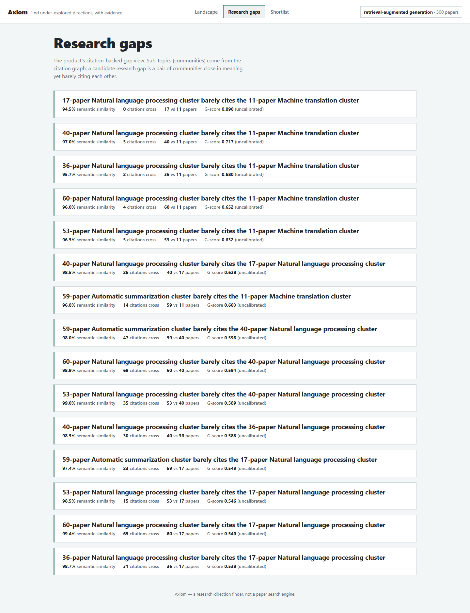
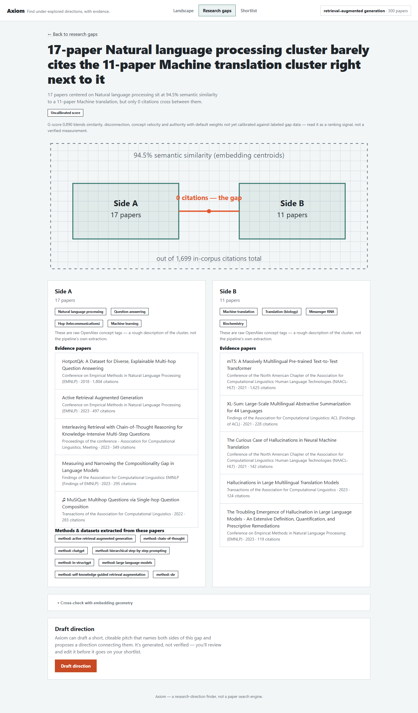

# Axiom

[](https://github.com/yabusko/axiom/actions/workflows/ci.yml)
**[Try the live demo](https://yabusko.github.io/axiom/)** — static build, recorded real data, no backend needed.

**A research-direction finder, not a paper search engine.** Point Axiom at a topic and it
surfaces two things from the citation graph: which concepts are accelerating, and which
closely-related areas of work barely cite each other despite sitting right next to each
other semantically — candidate thesis directions, each backed by real evidence papers, not
a hunch. Pick one, draft a citeable pitch, export it to the supervisor meeting.

## Screenshots

| Research gaps | Gap detail |
|---|---|
|  |  |

## How it works

1. **One shared, prebuilt corpus.** `scripts/build_corpus.py` fetches a domain (retrieval /
   RAG / QA / LLM-knowledge-use, 2019–2026) from OpenAlex once, embeds it (SPECTER2 dense +
   BM25 sparse, Qdrant) and runs the agentic extraction pipeline over it. This is the one
   step that costs real time and money — see the cost/time warning below.
2. **A "field" is an instant slice, not a download.** Typing a topic ranks the whole prebuilt
   corpus by cosine similarity to that topic and takes the top ~200 papers plus their 1-hop
   citation neighbors — milliseconds, no new fetch or LLM call (p50 0.164s / p95 0.389s,
   measured against the real 1000-paper corpus, `eval/field_latency.json`).
3. **Communities, then gaps.** Louvain community detection over the slice's citation subgraph
   finds sub-topics; a candidate gap is a pair of communities close in embedding space but
   weakly connected by citation. Labels come from the agent pipeline's own canonical concept
   extraction where there's enough of it, OpenAlex's raw tags otherwise.
4. **An external sanity check.** A real-time OpenAlex lookup counts how many published works
   already combine both sides' key concepts — many means the "gap" is likely an artifact of
   this corpus being small, not a real blind spot (`docs/DECISIONS.md` OD42).
5. **Draft, then export.** One LLM call drafts a citeable direction naming both sides,
   explicitly marked unverified. Keep it, add notes, export to Markdown.

## What's built

| Capability | Status |
|---|---|
| Prebuilt shared corpus + instant field slicing (no per-field download) | ✅ 1000 papers, p50 0.164s / p95 0.389s field creation |
| Citation graph + Louvain gap detection, percentile-framed similarity | ✅ real corpus run |
| Agent-extracted concept labels (fallback to OpenAlex tags), junk-filtered + cased | ✅ |
| AI gap judge (rubric: plausibility/novelty/actionability) | ✅ 43 gaps judged, $0.24 — **1/43 (2%) rated worth pursuing**, reported as-is (`eval/gap_judgments_report.md`) |
| External OpenAlex corpus-artifact check per gap | ✅ calibrated against 5 real label pairs (`docs/DECISIONS.md` OD42) |
| React + TypeScript SPA (Start, Landscape, Gaps, Gap detail, Shortlist, Map) | ✅ primary interface |
| 3D citation-graph / embedding Map view | ✅ lazy-loaded, main bundle stays ~102 KB gzip |
| Draft-direction + shortlist + Markdown export | ✅ |
| Static demo build + GitHub Pages deploy | ✅ `VITE_DEMO=1`, see the link above |
| CI (pytest on bare Python, web lint/typecheck/build, Playwright e2e) | ✅ `.github/workflows/ci.yml` |
| nDCG@10 retrieval eval (separate 1,500-paper ACL/EMNLP/COLING/NAACL sample) | ✅ mean 0.453 (hybrid), single-pass AI-drafted judgments |
| Eval re-pool v2 (dense/sparse/hybrid top-20, judged@10) | ⏸ deferred — listed, not started |
| Composite gap G-score (similarity/disconnection/velocity/authority) | ⚠️ uncalibrated defaults, shown as such in the UI |
| Streamlit lab console (Trending, Search, Reading list, Review queue, vector geometry) | ✅ still works, secondary to the React app |

## Run it

**Prerequisites:** Python 3.10–3.12 (not 3.13/3.14 — the pinned `torch`/`transformers` have
no wheels there), Docker (Qdrant), Node 20+, an [OpenAlex API key](https://openalex.org/settings/api)
(free) and an `ANTHROPIC_API_KEY` for the extraction/judging/drafting calls.

```bash
# 1. venv + pinned deps
python3.12 -m venv .venv && . .venv/bin/activate
pip install -r requirements.txt

# 2. Qdrant
docker compose up -d

# 3. Build the shared corpus (ONE TIME) -- see the warning below before running this
echo "OPENALEX_API_KEY=..." >> .env
echo "ANTHROPIC_API_KEY=..." >> .env
python scripts/build_corpus.py --size 1000 --yes

# 4. Backend
uvicorn api.main:app --reload        # docs at http://localhost:8000/docs

# 5. Frontend
cd web && npm install && npm run dev  # http://localhost:5173
```

> **Corpus build cost/time warning.** `build_corpus.py --size 1000` is real network +
> real LLM spend: the actual 1000-paper build this repo ships evidence for took **~39
> minutes and $0.41** (fetch + embed + full agent extraction + concept canonicalization;
> see `eval/corpus_build.json`). It's checkpointed and resumable, defaults to a `$3`
> budget cap, and asks for confirmation with a pre-flight cost estimate before spending
> anything — but don't run it on a metered connection without reading the estimate first.

### Tests

```bash
pip install -r requirements-dev.txt
pytest tests/ -q      # bare-Python safe -- conftest.py stubs torch/transformers/qdrant_client
cd web && npm run lint && npm run build && npx playwright test   # mocked API, no backend needed
```

### Distributed execution (optional)

The agent pipeline (coordinator → extraction → enrichment → linking) runs in-process
by default. To run each role as an independent, horizontally-scalable process talking
through Redis Streams instead (`axiom/workers.py`, OD43/OD44):

```bash
docker compose up -d redis worker-coordinator worker-enrichment worker-linking
docker compose up -d --scale worker-extraction=3 worker-extraction   # the one LLM-calling role
AXIOM_EXECUTION=distributed uvicorn api.main:app --reload            # POST /agents/run now only enqueues
```

Run status still comes from `GET /agents/runs/{id}` exactly as in local mode. Real
throughput (1 vs 3 extraction workers), p95 latency, and a fault-injection check
(`docker kill` one extraction worker mid-run, confirm every paper still finishes via
`XAUTOCLAIM` reclaim) are in `docs/distributed/RESULTS.md`.

## Architecture

```
OpenAlex (scripts/build_corpus.py, OD36)        db/schema.sql  ← shared data contract
        │                                              │
        ▼                                              ▼
Shared corpus: data/corpus/corpus.db  +  Qdrant corpus_v1
 (SPECTER2 dense + BM25 sparse, full agent extraction + canonicalization)
        │
        │ axiom/corpus_slice.py  — cosine-rank + 1-hop citation neighbors (OD37)
        ▼
"Field" = (topic, paper_ids) over the shared corpus — instant, no copy (axiom/fields.py)
        │
        │  axiom/graph.py (NetworkX, PageRank)   axiom/gaps.py (Louvain + gap scoring, OD9/OD17)
        │  axiom/velocity.py (trend ranking)     axiom/external_check.py (OpenAlex artifact check, OD42)
        ▼
┌───────────────────────────────┐        ┌──────────────────────────────┐
│ api/main.py (FastAPI)          │        │ app/streamlit_app.py          │
│ /fields/* -- the React app's   │        │ internal lab console:         │
│ real surface (OD33)            │        │ Trending, Search, Reading     │
│                                 │        │ list, Review queue, Advanced  │
└───────────────┬───────────────┘        └──────────────────────────────┘
                 │
                 ▼
web/ — React + Vite + TypeScript SPA (primary interface)
  VITE_DEMO=1 build → web/src/demoData.ts (no backend) → GitHub Pages
```

**Agentic extraction pipeline** (coordinator → extraction → enrichment → linking →
synthesis, `axiom/agents/*`): async, calls the Anthropic API with a local-Ollama fallback.
Full module map and contracts in `docs/agentic/ARCHITECTURE.md`; real run numbers in
`docs/agentic/RESULTS.md`. Runs in-process by default (`AXIOM_EXECUTION=local`); set
`AXIOM_EXECUTION=distributed` to run coordinator/extraction/enrichment/linking as
independent processes talking through Redis Streams instead (`axiom/workers.py`,
`docker compose up --scale worker-extraction=3` to scale the one LLM-calling role) --
see `docs/DECISIONS.md` OD43/OD44 and `docs/distributed/RESULTS.md` for the design and
real throughput/fault-injection numbers.

## Layout

```
db/schema.sql                    shared SQLite contract (papers, concepts, citation_edges,
                                  corpus_meta, paper_concepts, concept_cooccurrence, llm_spend, ...)
axiom/config.py                  paths, Qdrant config, all tunable constants
axiom/db.py                      SQLite connect/init/insert/query helpers (all SQL lives here)
axiom/ingest.py                  OpenAlex client -- pure Python, no torch
axiom/corpus_slice.py            A4: relevance-ranked slice of the shared corpus (OD37)
axiom/embed.py                   SPECTER2 encoder (GPU→CPU fallback)
axiom/sparse.py                  BM25-style sparse encoder
axiom/qdrant_client.py           AxiomQdrant: collection lifecycle, search, search_hybrid
axiom/graph.py                   NetworkX citation graph, PageRank influence
axiom/gaps.py                    Louvain gap detector + composite G-score (OD9/OD17)
axiom/velocity.py                trend/velocity engine
axiom/external_check.py          B1: OpenAlex corpus-artifact check per gap (OD42)
axiom/fields.py                  fields registry -- instant slice fields + legacy download fields
axiom/llm_providers.py           shared LLM client (Anthropic / local Ollama fallback), per-run
                                  budget ledger, tracing
axiom/agents/                    coordinator → extraction → enrichment → linking → synthesis
axiom/workers.py                 distributed workers (AXIOM_EXECUTION=distributed, OD43/OD44) --
                                  the same 4 agent roles as independent Redis Streams consumers

app/streamlit_app.py             internal lab console (secondary to web/)
api/main.py                      FastAPI service layer -- /fields/* is the React app's real surface
web/                              React + Vite + TypeScript SPA, the product surface (OD33)

scripts/build_corpus.py          builds/resumes/extends the shared prebuilt corpus (A2/A3)
scripts/judge_gaps.py            B1: AI judge rates top-10 gaps per topic against a rubric
scripts/measure_field_latency.py A7: real p50/p95 field-creation latency measurement
scripts/eval_ndcg.py             nDCG@10 harness (v1 + v2 modes)
scripts/smoke_test_api.py        FastAPI integration smoke test

eval/corpus_build.json           real build time/cost for the live corpus
eval/field_latency.json          real p50/p95 field-creation latency
eval/gap_judgments.json          real AI-judge output for 43 gaps across 5 topics
eval/report.md                   nDCG@10 report (separate 1,500-paper eval corpus)

tests/                           pytest suite; conftest stubs torch/transformers/qdrant_client
                                  so it runs on bare Python too (requirements-dev.txt)
.github/workflows/ci.yml         pytest + web lint/typecheck/build + Playwright e2e
.github/workflows/pages.yml      VITE_DEMO=1 build → GitHub Pages

docs/DECISIONS.md                every committed decision (OD1-OD42) + schema change log
docs/product/                    product definition, design system, demo script, screenshots
docs/agentic/                    agentic pipeline architecture + real results
docs/archive/                    superseded docs, kept for history
docker-compose.yml               Qdrant only
```

## Limitations

- **Corpus scope.** The shared corpus is domain-scoped (retrieval/RAG/QA/LLM knowledge use,
  2019–2026, 1000 papers) — a field outside that domain returns a thin slice; extend it with
  `scripts/build_corpus.py --extend TOPIC`.
- **Uncalibrated G-score.** `gap_score` and the composite `g_score` are ranking heuristics
  with uncalibrated default weights, shown as "uncalibrated" in the UI rather than hidden.
  An AI judge's own rubric rated only 1 of 43 real top-ranked gaps "worth pursuing" —
  reported honestly (`eval/gap_judgments_report.md`), not smoothed over.
- **Rising-concept noise.** The velocity engine ranks raw `paper_concepts` rows, which aren't
  run through the same junk-label filter the gap-labeling path uses — a rising concept can
  read as a generic OpenAlex tag rather than something field-specific.
- **English-only.** OpenAlex ingestion, SPECTER2, and the LLM prompts all assume English
  abstracts.
- **Single-user.** No auth; shortlist state is one shared list per field, not per-user.

## Troubleshooting

- **`build_corpus.py` exits immediately with no `OPENALEX_API_KEY`** → OpenAlex's keyless
  traffic is capped at ~$0.10/day shared per IP; get a free key at
  [openalex.org/settings/api](https://openalex.org/settings/api) and set it in `.env`.
- **Outbound HTTPS fails with `CERTIFICATE_VERIFY_FAILED`** (OpenAlex, HuggingFace,
  Anthropic) on a network with a TLS-inspecting proxy → export `AXIOM_OS_TRUSTSTORE=1`
  as a real environment variable (not just in `.env` — `axiom/config.py`'s truststore
  injection runs before dotenv loads) so the OS certificate store is trusted instead of
  `certifi`'s bundle.
- **"Cannot reach Qdrant"** → `docker compose up -d`, wait a few seconds, retry.
- **Slow first encode** → expected on CPU; SPECTER2 weights download once and are cached.

## Credits

Axiom started as a TUM team project; this repo continues independently. See
`docs/archive/Backlog.md` for the original task-by-task plan and `docs/DECISIONS.md` for
every architectural decision made since.
